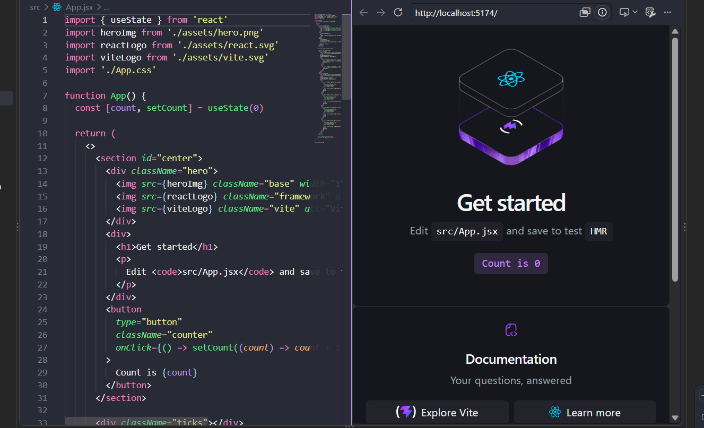
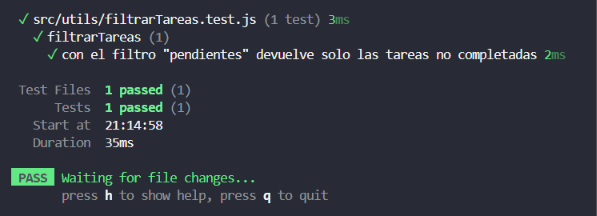
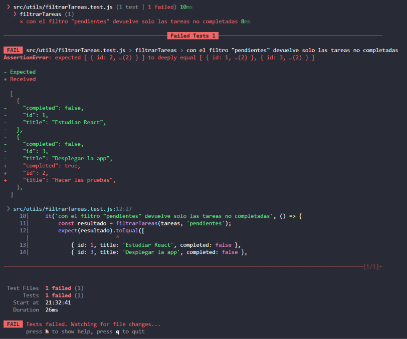
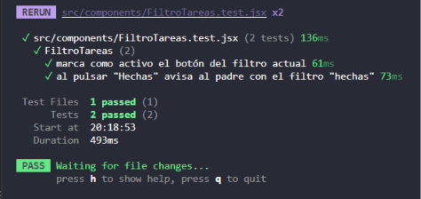
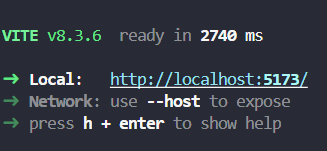
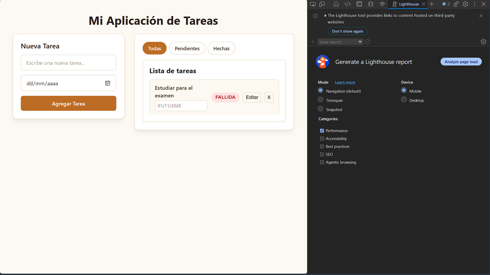
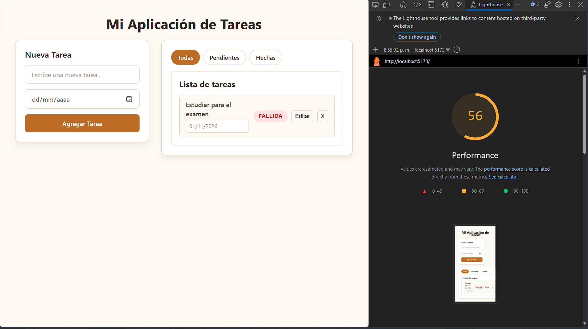
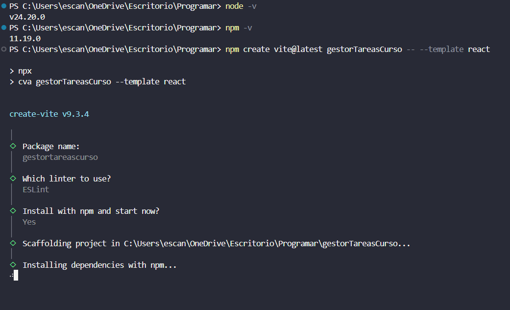
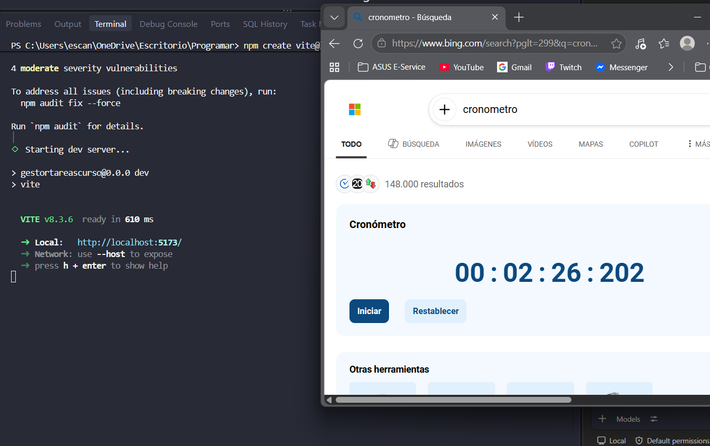

# Informe React

## Estudiantes:
Juan José Abril

Pablo Esteban Escandón

Mateo Sebastián Namicela

# Sección 1: Panorama General de React

## 1.1 Origen e Historia

React nació dentro de las oficinas de **Facebook** (hoy conocido como **Meta**) para resolver un problema concreto de escalabilidad en la interfaz de usuario: la actualización constante y dinámica del *Feed de Noticias* y las notificaciones en tiempo real.

* **Creador:** Jordan Walke, ingeniero de software en Facebook.

* **Año de creación/despliegue interno:** 2011 (aplicado en el Feed de Facebook) y 2012 (integrado en Instagram).

* **Lanzamiento Open Source:** Fue presentado públicamente en la conferencia **JSConf US en mayo de 2013**, transformando el desarrollo web al introducir el concepto del *Virtual DOM* y la programación declarativa basada en componentes.

## 1.2 Mantenimiento y Comunidad

Actualmente, React es mantenido de forma principal por **Meta** a través de un equipo especializado de ingenieros a tiempo completo (Core Team), junto con una comunidad global masiva de desarrolladores independientes, colaboradores de código abierto y empresas aliadas.

El desarrollo se gestiona públicamente en su repositorio oficial de GitHub bajo un modelo colaborativo respaldado por la fundación OpenJS/comunidad open-source.

## 1.3 Versión Actual y Licencia

* **Versión Actual:** **React 19** (con soporte nativo para *Server Components*, *Actions*, *Hooks* optimizados como `useActionState` y optimizaciones de compilación).

* **Licencia:** **MIT License** (Licencia de Software Libre permissiva).

  *Nota histórica:* En sus inicios, React utilizaba una licencia BSD + Patentes que generó controversia en la industria. En septiembre de 2017, Facebook migró formalmente React a la licencia **MIT**, permitiendo su uso comercial y privado sin restricciones significativas.

## 1.4 Filosofía del Paradigma: Librería vs. Framework

Para comprender la posición de React en el ecosistema, es necesario contrastar las tres filosofías principales del desarrollo frontend actual:

| Característica | **Angular** | **Vue.js** | **React** | 
| ----- | ----- | ----- | ----- | 
| **Clasificación** | Framework Completo (*Full-fledged*) | Framework Progresivo | **Librería UI** | 
| **Enfoque (*Scope*)** | Todo incluido (*Batteries-included*) | Adopción gradual | Solo la capa de vista (*View Layer*) | 
| **Toma de decisiones** | Opina sobre arquitectura, enrutado y estado | Proporciona herramientas oficiales modulares | Delegada al desarrollador/ecosistema | 

### Principios Filosóficos de React

* **Declarativo:** Defines *cómo debe verse* la UI según el estado actual, y React se encarga de actualizar el DOM real de forma eficiente.

* **Basado en Componentes:** La interfaz se divide en piezas independientes y reutilizables con su propia lógica y estado.

* **Aprende una vez, escribe donde sea (*Learn Once, Write Anywhere*):** Las bases de React sirven para web (`react-dom`), dispositivos móviles (`React Native`), 3D (`React Three Fiber`) y aplicaciones de escritorio.

## 1.5 Ficha Técnica

A continuación se resume la ficha técnica oficial de la tecnología analizada:

```
===================================================================
                        FICHA TÉCNICA: REACT
===================================================================
Nombre Oficial     : React (o React.js)
Categoría          : Librería JavaScript para Interfaces de Usuario
Creador Original   : Jordan Walke (Meta / Facebook)
Año de Lanzamiento : 2013 (Open Source)
Mantenido por      : Meta (Facebook) + Comunidad Open Source
Versión Estable    : React 19.x
Licencia           : MIT
Lenguaje Base      : JavaScript / TypeScript
Paradigma          : Declarativo, Basado en Componentes, Unidireccional
Arquitectura DOM   : Virtual DOM (Reconciliación con algoritmo Fiber)
Formato de UI      : JSX / TSX (JavaScript XML)
Sitio Oficial      : https://react.dev
===================================================================

```
# Sección 2: Instalación y Configuración Inicial con Vite

## 2.1 Creación del Proyecto con Vite

En el ecosistema frontend moderno, la herramienta de empaquetado y servidor de desarrollo por excelencia es **Vite**. Vite aprovecha los **ES Modules (ESM)** nativos del navegador para ofrecer un tiempo de arranque instantáneo y un reemplazo de módulos en caliente (*Hot Module Replacement* - HMR) extremadamente rápido.

Comparación de herramientas de scaffolding comunes:
- **Angular CLI (`ng new`):** Específico de Angular, configura TypeScript, RxJS y la arquitectura corporativa por defecto.
- **`create-vue` (`npm create vue@latest`):** Herramienta oficial para andamiaje de proyectos Vue.js emparejada con Vite.
- **Vite (`npm create vite@latest`):** Herramienta agnóstica de alto rendimiento compatible con React, Vue, Svelte y vanilla JS.

Para crear una aplicación React con Vite usando Node.js / `npm`, ejecutamos en la terminal:

```bash
npm create vite@latest mi-app-react -- --template react
cd mi-app-react
npm install
npm run dev
```

---

## 2.2 Estructura de Carpetas del Proyecto

Una vez completada la instalación, la estructura generada sigue un estándar limpio y modular:

```
mi-app-react/
├── node_modules/         # Dependencias instaladas vía npm
├── public/               # Recursos estáticos servidos directamente (favicon, manifest)
├── src/                  # Código fuente de la aplicación
│   ├── assets/           # Imágenes, fuentes y archivos multimedia de  la     app
│   ├── App.css           # Estilos específicos del componente principal App
│   ├── App.jsx           # Componente raíz de la aplicación
│   ├── index.css         # Estilos globales de la aplicación
│   ├── main.jsx          # Punto de entrada JavaScript / Renderizado inicial
│   └── vite-env.d.ts     # Definiciones de tipos para el entorno Vite (si se usa TS)
├── .gitignore            # Archivos excluidos del control de versiones de Git
├── index.html            # Plantilla HTML raíz del proyecto
├── package.json          # Manifiesto del proyecto y listado de dependencias
├── package-lock.json     # Bloqueo de versiones exactas de dependencias
└── vite.config.js        # Configuración del bundler Vite y sus plugins
```

---

## 2.3 Explicación del "Hola Mundo" Línea por Línea

Para comprender cómo arranca la aplicación, analizamos los dos archivos principales: `index.html` y `src/main.jsx`.

### 1. `index.html`

```html
<!doctype html>
<html lang="es">
  <head>
    <meta charset="UTF-8" />
    <meta name="viewport" content="width=device-width, initial-scale=1.0" />
    <title>Aplicación React</title>
  </head>
  <body>
    <!-- Nodo contenedor donde se montará React -->
    <div id="root"></div>

    <!-- Carga del punto de entrada en JS ESM -->
    <script type="module" src="/src/main.jsx"></script>
  </body>
</html>
```

* **`<div id="root"></div>`:** Este elemento actúa como el contenedor donde React inyectará toda la interfaz gráfica.
* **`<script type="module" src="/src/main.jsx"></script>`:** Indica al navegador que cargue el código como un módulo ES nativo.

---

### 2. `src/main.jsx`

```javascript
import { StrictMode } from 'react'
import { createRoot } from 'react-dom/client'
import './index.css'
import App from './App.jsx'

createRoot(document.getElementById('root')).render(
  <StrictMode>
    <App />
  </StrictMode>,
)
```

**Análisis línea por línea:**

1. `import { StrictMode } from 'react'`: Importa la herramienta de desarrollo `StrictMode`, la cual activa verificaciones adicionales y advertencias para el código en etapa de desarrollo (como identificar efectos secundarios o APIs obsoletas).
2. `import { createRoot } from 'react-dom/client'`: Importa la función de renderizado concurrente introducida en React, encargada de conectar la lógica de React con el DOM real del navegador.
3. `import './index.css'`: Importa los estilos CSS globales que afectarán a toda la aplicación.
4. `import App from './App.jsx'`: Importa el componente raíz `App`, que contiene la interfaz principal.
5. `createRoot(document.getElementById('root'))`: Busca el elemento HTML con la ID `root` y crea una raíz de renderizado de React sobre él.
6. `.render(...)`: Ejecuta el ciclo de renderizado montando los elementos hijos dentro del nodo raíz en el DOM.

Usualmente los proyectos cuando son creados no suelen tener una pantalla "vacía", sino un código de ejemplo en App.HTML, en el caso de vite se logra visualizar algo así:




---
Las mediciones realizadas se encuentran en el apartado de mediciones al final del informe.

# Sección 3: Componentes y Fundamentos de React

## 3.1 Componentes y JSX

React se basa en **componentes funcionales**, los cuales son funciones de JavaScript que retornan marcas visuales escritas en **JSX (JavaScript XML)**. JSX nos permite escribir estructuras similares a HTML dentro del código JavaScript.

### Reglas clave de JSX:
1. Deve retornar un único elemento padre (o un *Fragment* `<> ... </>`).
2. Se utilizan nombres de propiedades camelCase (`className` en vez de `class`, `htmlFor` en vez de `for`).
3. Se pueden evaluar expresiones de JavaScript arbitrarias encerrándolas en llaves `{ }`.

---

## 3.2 Props (Entradas de Datos)

Las **props** (propiedades) son argumentos que se pasan a los componentes para configurarlos de forma dinámica desde su componente padre. En React, las props son de **solo lectura** (*inmutables*).

---

## 3.3 Eventos

Los eventos en React se nombran en camelCase (por ejemplo, `onClick`, `onChange`, `onSubmit`). Se les pasa una función como manejador del evento en lugar de una cadena de texto.

```jsx
function BotonAccion({ texto, alHacerClic }) {
  return (
    <button onClick={alHacerClic} className="btn-primario">
      {texto}
    </button>
  );
}
```

---

## 3.4 Renderizado Condicional y Listas

- **Condicionales:** Se ejecutan comúnmente usando el operador ternario (`condicion ? a : b`) o el operador lógico `&&` (`condicion && elemento`).
- **Listas:** Se procesan transformando arreglos de datos en elementos JSX mediante el método `.map()`. Cada elemento de una lista renderizada **debe llevar una propiedad única `key`** para permitir una reconciliación eficiente del Virtual DOM.

---

## 3.5 Ciclo de Vida en Componentes Funcionales

En React moderno, el ciclo de vida de un componente (montaje, actualización y desmontaje) se gestiona mediante el Hook `useEffect`:

1. **Montaje (Mounting):** El componente se inserta en el DOM. Se ejecuta el bloque del `useEffect` si su arreglo de dependencias está vacío `[]`.
2. **Actualización (Updating):** Se ejecuta cuando cambian las dependencias listadas en el arreglo de dependencias `[dep1, dep2]`.
3. **Desmontaje (Unmounting):** Ocurre cuando el componente se remueve del DOM. Se gestiona retornando una *función de limpieza* (*cleanup function*) desde el `useEffect`.

---

## 3.6 Ejemplo Integrado: Componente Reutilizable Usado 3 Veces

A continuación se muestra el código completo de la creación de tareas para la lista (`ItemTarea`) reutilizable.

```jsx
export default function ItemTarea({ tarea, alEliminar, alAlternar, alIniciarEdicion }) {
    
    const convertirFechaAObjeto = (fechaStr) => {
        if (!fechaStr) return new Date(0);
        const [dia, mes, anio] = fechaStr.split('/');
        return new Date(`${anio}-${mes}-${dia}`);
    };

    const esFechaVencida = (fechaStr) => {
        if (!fechaStr) return false;
        const [dia, mes, anio] = fechaStr.split('/');
        const fechaTarea = new Date(anio, mes - 1, dia);
        fechaTarea.setHours(0, 0, 0, 0);
        
        const hoy = new Date();
        hoy.setHours(0, 0, 0, 0);

        return fechaTarea < hoy;
    };

    const vencida = esFechaVencida(tarea.fecha);
    let estadoTexto = '';
    let claseEstado = '';

    if (tarea.completed) {
        estadoTexto = 'Completada';
        claseEstado = 'estado-completada';
    } else if (vencida) {
        estadoTexto = 'Fallida';
        claseEstado = 'estado-fallida';
    } else {
        estadoTexto = 'Pendiente';
        claseEstado = 'estado-pendiente';
    }

    return (
        <li className="item-tarea">
            <div className="info-tarea">
                <span className={tarea.completed ? 'texto-tarea completada' : 'texto-tarea'}>
                    {tarea.title}
                </span>
                {tarea.fecha && (
                    <span className="fecha-tarea">
                        {tarea.fecha}
                    </span>
                )}
            </div>
            
            <div className="acciones-tarea">
                <button 
                    className={`badge-estado ${claseEstado}`}
                    onClick={() => alAlternar(tarea.id, tarea.completed)}
                    title="Haz clic para cambiar estado"
                >
                    {estadoTexto}
                </button>

                <button 
                    className="boton-accion"
                    onClick={() => alIniciarEdicion(tarea)}
                    title="Editar tarea"
                >
                    Editar
                </button>

                <button 
                    className="boton-accion eliminar"
                    onClick={() => alEliminar(tarea.id)}
                    title="Eliminar tarea"
                >
                    X
                </button>
            </div>
        </li>
    );
}
```

---

# Sección 4: Estado y Reactividad

## 4.1 El Modelo de Reactividad en React

A diferencia de otros frameworks como Vue o Svelte, React **no utiliza reactividad basada en observables o proxies invisibles** por defecto. En su lugar, React emplea un modelo de re-renderizado explícito e inmutabilidad.

Cuando el estado de un componente cambia, React vuelve a ejecutar la función del componente, genera un nuevo Virtual DOM y calcula las diferencias (reconciliación) para aplicar únicamente los cambios necesarios en el DOM real.

```
[ Cambio de Estado ] ──► [ Re-ejecución del Componente ] ──► [ Diff en Virtual DOM ] ──► [ Actualización del DOM ]
```

## 4.2 Reactividad local: Hooks y Refs

En React moderno (basado en componentes funcionales), la reactividad y la preservación de valores entre renders se gestiona a través de **Hooks** y **Refs**.

### 1. useState y useReducer (Estado Reactivo): 

* useState: Es el hook fundamental para manejar estado reactivo local. Cada actualización notifica a React que el componente debe re-renderizarse.
* useReducer: Ideal para lógica de estado compleja o múltiples sub-valores interconectados (sigue el patrón Redux de acción $\rightarrow$ reducer $\rightarrow$ nuevo estado).
* Inmutabilidad: En React, el estado nunca debe mutarse directamente. Siempre se debe proveer un nuevo objeto o valor (setCount(prev => prev + 1)).

### 2. useRef (Estado Persistente no Reactivo)

* Un ref es un contenedor cuyo atributo .current guarda un valor mutable a lo largo de las re-ejecuciones del componente.

* Diferencia clave: Modificar un ref NO desencadena un re-renderizado. Se usa principalmente para acceder a elementos del DOM de forma directa o para almacenar IDs de temporizadores y variables de referencia.

### 3. Reactividad Granular: React vs. Signals

En frameworks como Vue (ref/reactive), Solid.js o Angular (con sus Signals incorporadas recientemente), la reactividad es extremadamente fina (fine-grained): solo el nodo específico del DOM suscrito a la señal se actualiza sin re-ejecutar toda la función del componente.

En React:

* Signals en React: Aunque React no incluye Signals de forma nativa en su núcleo, librerías como @preact/signals-react o legend-state traen este concepto al ecosistema.

* React Compiler (React 19): React ha optado por automatizar la memorización (reemplazando la necesidad manual de useMemo y useCallback) mediante su nuevo compilador, manteniendo el modelo mental clásico basado en componentes.

## 4.3 Estado global
Cuando la aplicación crece, pasar datos a través de props por múltiples niveles jerárquicos (Prop Drilling) se vuelve insostenible. El ecosistema de React ofrece diversas estrategias para el estado global:

### 1. React Context API (Nativo)
Es una característica integrada en React para compartir valores en un árbol de componentes sin necesidad de pasar props manualmente.

* Ventajas: No requiere dependencias externas; excelente para datos estáticos o de baja frecuencia de cambio (ej. tema oscuro, usuario autenticado, idioma).
* Desventajas: Cada vez que el valor del contexto cambia, todos los componentes consumidores se re-renderizan, lo que puede causar problemas de rendimiento en aplicaciones grandes si el estado cambia con frecuencia.

### 2. Librerías de Estado Global: Zustand, Redux Toolkit, Jotai

Para superar las limitaciones de Context API, se utilizan librerías de estado de tercera parte:

* **Zustand**: Muy popular por su simplicidad y bajo peso. Utiliza un almacén central (store) basado en suscripciones, permitiendo que solo los componentes que seleccionan una propiedad específica se re-rendericen (useStore(state => state.bears)).

* **Redux Toolkit (RTK)**: La solución empresarial tradicional, basada en un flujo unidireccional estricto de datos con acciones y reductores.

* **Jotai / Recoil**: Soluciones basadas en átomos, permitiendo una reactividad bottom-up (de abajo hacia arriba).

### Comparativa con otros Frameworks

| Aspecto | **React** | **Vue.js** | **Angular** |
| ----- | ----- | ----- | ----- |
| **Solución Oficial** | Context API (Nativo) | Pinia | Servicios Inyectables + RxJS / Signals |
| **Arquitectura de Estado** | Descentralizada / Basada en Hooks o Stores externos (Zustand, Redux) | Store centralizado de reactividad fina (Pinia) | Inyección de Dependencias (*Dependency Injection*) |
| **Suscripción a cambios** | Selectores explícitos o re-renderizado de subtree | Automático a nivel de propiedad por Proxies | Vía *AsyncPipe*, Observables RxJS o Signals |

---

## 4.4 Estado Compartido entre 2 Componentes

Para compartir estado entre dos componentes en React, existen tres patrones principales según el nivel de acoplamiento y distancia en el árbol de componentes.

### Patrón 1: Elevación de Estado (Lifting State Up) Patrón Canónico
Cuando dos componentes hermanos necesitan compartir información, el estado debe elevarse al ancestro común más cercano.

```
         [ Componente Padre ]
         (Contiene `useState`)
            /           \
           /             \
   [ Componente A ]   [ Componente B ]
  (Recibe el valor)  (Recibe la función setter)
```

### Ejemplo práctico:

```jsx
import { useState } from 'react';

// Componente Hermano A: Emisor (modifica el estado)
function InputComponent({ valor, onCambio }) {
  return (
    <input 
      type="text" 
      value={valor} 
      onChange={(e) => onCambio(e.target.value)} 
      placeholder="Escribe algo..."
    />
  );
}

// Componente Hermano B: Receptor (muestra el estado)
function DisplayComponent({ valor }) {
  return <p>El texto ingresado es: <strong>{valor}</strong></p>;
}

// Componente Padre: Mantiene la "Fuente de la Verdad" (Single Source of Truth)
export default function Padre() {
  const [texto, setTexto] = useState('');

  return (
    <div className="p-4 border rounded">
      <h3>Estado Compartido (Lifting State Up)</h3>
      <InputComponent valor={texto} onCambio={setTexto} />
      <DisplayComponent valor={texto} />
    </div>
  );
}
```

### Patrón 2: Mediante React Context
Si los dos componentes están lejanos en la jerarquía, se crea un `Provider` que envuelva la rama del árbol donde residen ambos componentes.

### Patrón 3: Mediante un Store Externo (ej. Zustand)
Si los dos componentes están totalmente desvinculados en el árbol de componentes, ambos se suscriben de forma independiente al mismo *store* global sin requerir un componente padre común en la jerarquía del DOM.

# Sección 5: Rutas y Consumo de APIs

## 5.1 Enrutamiento con React Router

React en sí mismo no incluye un enrutador interno. La librería estándar de la industria para resolver la navegación entre vistas en una Single Page Application (SPA) es **React Router** (`react-router-dom`).

Instalación:
```bash
npm install react-router-dom
```

### Configuración básica de rutas:

```jsx
import { BrowserRouter, Routes, Route, Link } from 'react-router-dom';

function Inicio() { return <h2>Página de Inicio</h2>; }
function Acerca() { return <h2>Acerca de Nosotros</h2>; }

export function AppRouter() {
  return (
    <BrowserRouter>
      <nav>
        <Link to="/">Inicio</Link> | <Link to="/acerca">Acerca</Link>
      </nav>
      <Routes>
        <Route path="/" element={<Inicio />} />
        <Route path="/acerca" element={<Acerca />} />
      </Routes>
    </BrowserRouter>
  );
}
```

---

## 5.2 Consumo de API REST, Manejo de Carga y Errores

Para interactuar con servicios externos, se hace uso de la API nativa de JavaScript `fetch` (o librerías como `axios` o `HttpClient` en otros ecosistemas) coordinada con el estado (`useState`) y los efectos de React (`useEffect`).

A continuación se presenta un patrón completo que incluye:
1. Indicador visual de estado de carga (*Loading state*).
2. Manejo y captura de errores HTTP/Red (*Error state*).
3. Renderizado de los datos consumidos.

```jsx
const actualizarTareaEnAPI = (id, datosActualizados, onTerminado) => {
    let fechaFormateada = datosActualizados.fecha;

    if (datosActualizados.fecha && datosActualizados.fecha.includes('-')) {
        const [anio, mes, dia] = datosActualizados.fecha.split('-');
        fechaFormateada = `${dia}/${mes}/${anio}`;
    }

    const datosParaEnviar = {
        title: datosActualizados.titulo,
        fecha: fechaFormateada
    };

    setErrorAccion(null);
    setCargandoAccion(true);

    fetch(`https://apitareas-6fki.onrender.com/tareas/${id}`, {
        method: 'PUT', //Se envían los cambios para guardarse
        headers: {
            'Content-Type': 'application/json'
        },
        body: JSON.stringify(datosParaEnviar)
    })
        .then((respuesta) => {
            if (!respuesta.ok) {
                throw new Error(`Error en el servidor: ${respuesta.status} (${respuesta.statusText})`);
            }
            return respuesta.json();
        })
        .then((tareaActualizada) => {
            setTareas((tareasAnteriores) =>
                tareasAnteriores.map((t) => (t.id === id ? tareaActualizada : t))
            );
            setTareaAEditar(null);
            if (onTerminado) onTerminado();
        })
        .catch((error) => {
            console.error('Error detallado al actualizar la tarea:', error);
            // Guardamos el mensaje para mostrárselo al usuario en caso de error
            setErrorAccion(error.message || 'No se pudo conectar con el servidor.');
            
        })
        .finally(() => {
            setCargandoAccion(false);
        });
};
```

---

# Sección 6: Pruebas

## 6.1 ¿Qué son las pruebas automatizadas y cuáles son sus tipos?

Una prueba automatizada es código que sirve para verificar que otra parte del código funcione como se espera. De esta manera se evita la tarea de abrir el navegador y comprobar todo de forma manual: el programa lo comprueba en cuestión de milisegundos y las veces que sean necesarias. Si alguien modifica una función y la rompe, la prueba falla y avisa antes de que el error llegue a la aplicación publicada.

### Tipos de pruebas

| **Tipo** | **Qué prueba** | **Ejemplo en nuestra app** |
| ----- | ----- | ----- |
| Unitaria | Una función aislada | `filtrarTareas` devuelve solo las pendientes |
| De componente | Un componente renderizado | Al pulsar "Hechas", el botón queda activo |
| Integración | Varias piezas juntas | La lista carga tareas desde la API |
| E2E | La app completa, como un usuario | Abrir la app, crear una tarea y verla en la lista |

En este proyecto se realizaron **pruebas unitarias** (3) y **pruebas de componente** (2).

## 6.2 Herramientas utilizadas

Cada herramienta cumple un papel distinto dentro del proceso de pruebas:

| Herramienta | Papel |
|---|---|
| **Vitest** | Es el ejecutor: encuentra los archivos `.test.js` / `.test.jsx`, los ejecuta y muestra el resultado |
| **jsdom** | Simula un navegador dentro de Node.js, ya que las pruebas no abren Chrome ni ningún navegador real |
| **React Testing Library** | Renderiza los componentes y permite buscarlos como lo haría un usuario (por su texto o por su rol) |
| **jest-dom** | Añade comprobaciones más legibles, como `toBeInTheDocument()` o `toHaveAttribute()` |
| **user-event** | Simula las acciones del usuario, como hacer clic o escribir |

### ¿Por qué Vitest y no otra herramienta?

- **Vitest:** el proyecto se creó con **Vite**, y Vitest reutiliza esa misma configuración. Gracias a eso entiende JSX y los `import` sin necesidad de configurar nada adicional.
- **Jest:** es la herramienta clásica para probar aplicaciones React, pero en un proyecto creado con Vite necesita configuración extra para entender JSX y los módulos. Su sintaxis es casi idéntica a la de Vitest (`describe`, `it`, `expect`), por lo que lo aprendido sirve para ambas.
- **Jasmine + Karma:** es la combinación que Angular usó históricamente, y ejecuta las pruebas dentro de un navegador real. Sin embargo, a partir de **Angular 21** (noviembre de 2025), Vitest pasó a ser el ejecutor de pruebas por defecto en los proyectos nuevos creados con el CLI; Karma sigue disponible como opción (`ng new mi-app --test-runner=karma`). Esto muestra que el ecosistema en general se está moviendo hacia Vitest.

React Testing Library se basa en un principio central: mientras más se parezcan las pruebas a la forma en que se usa realmente el software, más confianza pueden darnos. ([Guiding Principles – Testing Library](https://testing-library.com/docs/guiding-principles/))

## 6.3 Instalación y configuración

Las herramientas se instalaron como **dependencias de desarrollo** (`-D`): solo se usan mientras se programa y se prueba, y no se incluyen en la aplicación publicada.

```bash
npm install -D vitest @testing-library/react @testing-library/jest-dom @testing-library/user-event jsdom
```

En `package.json` se agregó el script `test`, que permite ejecutar las pruebas con `npm test`:

```json
"scripts": {
  "dev": "vite",
  "build": "vite build",
  "lint": "eslint .",
  "preview": "vite preview",
  "test": "vitest"
}
```

Para las pruebas de componente se configuró Vitest en `vite.config.js`:

```js
export default defineConfig({
  plugins: [react()],
  test: {
    environment: 'jsdom',
    setupFiles: './src/test/setup.js',
  },
})
```

- `environment: 'jsdom'` hace que las pruebas se ejecuten dentro del navegador simulado, porque Node.js no tiene `document` ni elementos HTML.
- `setupFiles` indica un archivo que se ejecuta antes de cada archivo de pruebas.

El archivo `src/test/setup.js` carga las comprobaciones de jest-dom y limpia lo que se dibujó después de cada prueba (sin la limpieza, la segunda prueba encontraba también los botones de la primera):

```js
import '@testing-library/jest-dom/vitest';
import { afterEach } from 'vitest';
import { cleanup } from '@testing-library/react';

afterEach(() => {
  cleanup();
});
```

Vitest reconoce como prueba cualquier archivo cuyo nombre termine en `.test.js`, `.test.jsx`, `.spec.js`, etc.

## 6.4 Ejemplo propio: pruebas unitarias de `filtrarTareas`

### Por qué separamos la lógica en `utils`

La lógica de filtrado se separó del componente y se colocó en una función dentro de la carpeta `utils`. Se trata de una **función pura**: recibe datos y devuelve datos, sin depender de la pantalla ni de nada externo. Este tipo de funciones es el más fácil de probar, porque basta con darle una entrada y comprobar la salida.

### Código de la función (`src/utils/filtrarTareas.js`)

```js
export function filtrarTareas(tareas, filtro) {
    if (filtro === 'pendientes') {
        return tareas.filter((tarea) => !tarea.completed);
    }

    if (filtro === 'hechas') {
        return tareas.filter((tarea) => tarea.completed);
    }

    return tareas;
}
```

### Código de las pruebas (`src/utils/filtrarTareas.test.js`)

```js
import { describe, it, expect } from 'vitest';
import { filtrarTareas } from './filtrarTareas';

describe('filtrarTareas', () => {
    const tareas = [
        { id: 1, title: 'Estudiar React', completed: false },
        { id: 2, title: 'Hacer las pruebas', completed: true },
        { id: 3, title: 'Desplegar la app', completed: false },
    ];

    it('con el filtro "pendientes" devuelve solo las tareas no completadas', () => {
        const resultado = filtrarTareas(tareas, 'pendientes');
        expect(resultado).toEqual([
            { id: 1, title: 'Estudiar React', completed: false },
            { id: 3, title: 'Desplegar la app', completed: false },
        ]);
    });

    it('con el filtro "hechas" devuelve solo las tareas que se han completado', () => {
        const resultado = filtrarTareas(tareas, 'hechas');
        expect(resultado).toEqual([
            { id: 2, title: 'Hacer las pruebas', completed: true },
        ]);
    });

    it('con el filtro "todas" devuelve todas las tareas', () => {
        const resultado = filtrarTareas(tareas, 'todas');
        expect(resultado).toEqual(tareas);
    });
});
```

### El patrón AAA

Cada prueba sigue el patrón **AAA** (*Arrange, Act, Assert*):

1. **Preparar (Arrange):** se crean los datos de entrada, en este caso una lista de tareas.
2. **Ejecutar (Act):** se llama a la función `filtrarTareas` con esos datos.
3. **Comprobar (Assert):** se verifica con `expect` que el resultado es el esperado.

### Por qué usamos datos inventados y no la API

En las pruebas se usaron tareas inventadas en lugar de pedirlas a la API por tres razones:

- **Rapidez:** no hay que esperar ninguna respuesta de red.
- **Resultados predecibles:** los datos siempre son los mismos, así que el resultado esperado también.
- **Fallos con sentido:** la prueba solo falla si el código está mal, y no por problemas ajenos como que la API esté caída o que sus datos hayan cambiado.

### Por qué `toEqual` y no `toBe`

`toBe` comprueba que dos valores sean **exactamente el mismo objeto** en memoria. Como `.filter()` crea siempre un **arreglo nuevo**, el resultado nunca será el mismo objeto que el arreglo esperado, aunque tenga el mismo contenido. Por eso se usa `toEqual`, que compara el **contenido** elemento por elemento.

### Resultado: la primera prueba pasando



### Comprobación: romper la función a propósito

Para demostrar que las pruebas realmente detectan errores, se modificó la función quitando el operador `!` de la condición del filtro `'pendientes'`. Al ejecutar las pruebas, estas fallaron y Vitest mostró la diferencia entre el valor esperado (*Expected*: las tareas 1 y 3) y el valor obtenido (*Received*: la tarea 2, que es la completada). Después se restauró el `!` y las pruebas volvieron a pasar.



## 6.5 Prueba de componente: `FiltroTareas`

`FiltroTareas` es el componente que muestra los botones **Todas**, **Pendientes** y **Hechas**. No conoce las tareas ni filtra nada: solo recibe el filtro activo (`filtroActual`) y una función para avisar al componente padre cuando el usuario elige otro filtro (`alCambiarFiltro`). Por eso la prueba revisa esas dos responsabilidades.

### Código de las pruebas (`src/components/FiltroTareas.test.jsx`)

```jsx
import { describe, it, expect, vi } from 'vitest';
import { render, screen } from '@testing-library/react';
import userEvent from '@testing-library/user-event';
import FiltroTareas from './FiltroTareas';

describe('FiltroTareas', () => {
  it('marca como activo el botón del filtro actual', () => {
    render(<FiltroTareas filtroActual="pendientes" alCambiarFiltro={() => {}} />);

    expect(screen.getByRole('button', { name: 'Pendientes' })).toHaveAttribute('aria-pressed', 'true');
    expect(screen.getByRole('button', { name: 'Todas' })).toHaveAttribute('aria-pressed', 'false');
  });

  it('al pulsar "Hechas" avisa al padre con el filtro "hechas"', async () => {
    const alCambiarFiltro = vi.fn();
    render(<FiltroTareas filtroActual="todas" alCambiarFiltro={alCambiarFiltro} />);

    await userEvent.click(screen.getByRole('button', { name: 'Hechas' }));

    expect(alCambiarFiltro).toHaveBeenCalledWith('hechas');
  });
});
```

### Qué hace cada parte

- **`render(...)`** dibuja el componente dentro del navegador simulado (jsdom) y le pasa las props, igual que lo haría `App`.
- **`screen.getByRole('button', { name: 'Pendientes' })`** busca el botón por su rol y su texto, es decir, como lo vería un usuario, y no por clases CSS.
- **`toHaveAttribute('aria-pressed', 'true')`** comprueba que el botón esté marcado como activo. El atributo `aria-pressed` se agregó por accesibilidad (lo leen los lectores de pantalla) y además sirve para probar qué filtro está activo.
- **`vi.fn()`** crea una función espía (*mock*): no hace nada, pero registra cuándo la llaman y con qué datos. Se usa en lugar del `setFiltro` real de `App`, porque aquí solo se prueba `FiltroTareas`.
- **`await userEvent.click(...)`** simula el clic del usuario. Lleva `await` porque hay que esperar a que el clic termine antes de comprobar el resultado.
- **`toHaveBeenCalledWith('hechas')`** verifica que, al hacer clic, el componente avisó al padre con el filtro correcto.

Las pruebas de componente tardan más que las unitarias (alrededor de 60–70 ms frente a 0–2 ms), porque hay que dibujar el componente y simular las acciones del usuario.



## 6.6 Errores encontrados y cómo se solucionaron

### Error 1: `Unexpected JSX expression` en el archivo de pruebas

**Qué se vio:** al crear la prueba del componente, Vitest no pudo ejecutar el archivo y mostró:

```
[PARSE_ERROR] Unexpected JSX expression
   ╭─[ src/components/FiltroTareas.test.js:8:12 ]
 8 │     render(<FiltroTareas filtroActual="pendientes" alCambiarFiltro={() => {}} />);
   │
   │ Help: JSX syntax is disabled and should be enabled via the parser options
```

**Cuál era la causa:** el archivo se había creado con la extensión `.js`. Vite decide cómo leer cada archivo según su extensión, y en un `.js` espera JavaScript puro, que no entiende etiquetas como `<FiltroTareas />`. El error señalaba justo el `<` de la línea 8.

**Cómo se solucionó:** se renombró el archivo a `FiltroTareas.test.jsx`. Las pruebas de `filtrarTareas` sí funcionan como `.js` porque no contienen JSX.

### Error 2: la fecha de hoy aparecía como "Fallida"

**Qué se vio:** al probar el filtro manualmente en la aplicación, una tarea cuya fecha límite era el día de hoy (8 de noviembre de 2026) aparecía marcada como **"Fallida"**, aunque todavía no había vencido.

**Cuál era la causa:** en `ListarTareas.jsx` la fecha se creaba a partir de un texto con `` new Date(`${anio}-${mes}-${dia}`) ``. Cuando JavaScript recibe una fecha en formato `AAAA-MM-DD` sin hora, la interpreta en **UTC** (medianoche en hora universal). Como Ecuador está en UTC−5, esa medianoche UTC corresponde en hora local al **7 de noviembre a las 19:00**. Por eso la aplicación consideraba que la fecha ya había pasado.

```js
new Date("2026-11-08");
// En Ecuador: Sat Nov 07 2026 19:00:00 GMT-0500
```

**Cómo se soluciona:** se reportó a Juan José, responsable de `ListarTareas.jsx`. La corrección consiste en crear la fecha con el constructor que recibe año, mes y día por separado, que sí usa la **hora local**. El mes se resta en 1 porque en JavaScript los meses van de 0 (enero) a 11 (diciembre):

```js
const [dia, mes, anio] = fechaStr.split('/');
new Date(anio, mes - 1, dia);
// En Ecuador: Sun Nov 08 2026 00:00:00 GMT-0500
```

Este error muestra el valor de probar: no lo habríamos notado si no hubiéramos revisado el comportamiento del filtro con una fecha concreta.

## 6.7 Cómo ejecutar las pruebas

Para ejecutar las pruebas se usa el comando:

```bash
npm test
```

Vitest se ejecuta en **modo vigilancia** (*watch mode*): después de la primera ejecución se queda esperando y vuelve a correr automáticamente las pruebas de los archivos que se modifican. Con la tecla **`a`** se vuelven a ejecutar todas las pruebas, y con **`q`** se sale. En total el proyecto tiene **5 pruebas en 2 archivos**.

### Cómo leer el resultado

- **✓** indica que la prueba pasó.
- **×** indica que la prueba falló.
- Cuando una prueba falla, Vitest muestra un bloque como este:

```diff
- Expected
+ Received
```

Las líneas con **`-`** muestran lo que la prueba esperaba obtener, y las líneas con **`+`** muestran lo que el código realmente devolvió. Comparar ambas permite encontrar rápidamente dónde está el error.

## 6.8 Fuentes

- Vitest, guía oficial: https://vitest.dev/guide/
- React Testing Library: https://testing-library.com/docs/react-testing-library/intro/
- Principios de Testing Library: https://testing-library.com/docs/guiding-principles/
- jest-dom: https://github.com/testing-library/jest-dom
- jsdom: https://github.com/jsdom/jsdom
- Jest: https://jestjs.io/
- Angular, pruebas con Karma (Vitest como ejecutor por defecto): https://angular.dev/guide/testing/karma
- Novedades de Angular 21: https://blog.ninja-squad.com/2025/11/20/what-is-new-angular-21.0

---

# Sección 7: Ecosistema y Despliegue

## 7.1 CLI y React DevTools

- **CLI (Command Line Interface):** Vite proporciona una interfaz de línea de comandos para compilar, servir localmente y ejecutar pruebas del proyecto.
- **React Developer Tools:** Extensión oficial para navegadores (Chrome, Firefox, Edge) que permite inspeccionar la jerarquía de componentes de React en tiempo real, visualizar sus `props`, `state` y Hooks, así como evaluar el rendimiento mediante su pestaña de profiling.

---

## 7.2 Librerías de UI Popularizadas

React no incluye componentes de UI estilizados nativos, por lo que la industria utiliza librerías de componentes preconstruidos:

- **Tailwind CSS:** Framework CSS *utility-first* altamente adoptado para construir interfaces a medida.
- **MUI (Material UI):** Implementación popular del sistema de diseño Material Design de Google para React.
- **Shadcn/ui / Radix UI:** Colección de componentes accesibles y sin estilos predeterminados sobre los cuales se conserva el control total del código fuente.
- **Ant Design:** Librería de UI orientada a aplicaciones enterprise y dashboards administrativos.

---

## 7.3 Build de Producción

Para compilar la aplicación y optimizarla para producción, ejecutamos:

```bash
npm run build
```

**Proceso interno:**
1. Vite procesa los archivos JSX y módulos de JavaScript.
2. Transpila el código (por ejemplo, eliminando tipos o sintaxis obsoleta).
3. Aplica **Tree Shaking** para eliminar código no utilizado.
4. Genera archivos HTML, JS y CSS minificados y divididos en fragmentos (*Code Splitting*) dentro del directorio `dist/`.

Para probar localmente el build compilado:
```bash
npm run preview
```

---

## 7.4 Plataformas de Despliegue

### 1. Vercel
Es el entorno nativo sugerido para frontend. Se conecta mediante Git:
1. Subir el repositorio a GitHub/GitLab.
2. Importar el proyecto desde el panel de Vercel.
3. Vercel detecta Vite automáticamente. El comando de build es `npm run build` y la carpeta de salida es `dist`.

### 2. Netlify
1. Conectar el repositorio de Git en Netlify.
2. Configurar Build Command: `npm run build`.
3. Configurar Publish directory: `dist`.
4. Agregar un archivo `_redirects` en la carpeta `public/` con la regla `/* /index.html 200` para soportar enrutamiento del lado del cliente.

### 3. GitHub Pages
1. Instalar el paquete de despliegue: `npm install -D gh-pages`.
2. En `vite.config.js`, definir la propiedad `base: '/nombre-del-repositorio/'`.
3. Agregar scripts en `package.json`:
   ```json
   "scripts": {
     "predeploy": "npm run build",
     "deploy": "gh-pages -d dist"
   }
   ```
4. Ejecutar `npm run deploy`.


Para el despliegue de la aplicación se uso Vercel, en el cual se subío el repositorio para generar la URL:

https://desarrollo-interactivo-app.vercel.app/

---

# Mediciones

**Métrica:** Tiempo de configuración inicial (min)
Para instalar el proyecto se debe tener Node.js instalado previamente para su correcto funcionamiento. En este proyecto se utilizó Vite, la herramienta recomendada en el sitio oficial de React para la creación y gestión del proyecto.

Se utilizó el editor de código Visual Studio Code. Desde la consola integrada, primero verificamos que Node.js y el gestor de paquetes npm se encuentren disponibles ejecutando:

``` python
node -v

npm -v
```

### Creación el proyecto con Vite:
Se ejecuta el comando de inicialización:

``` Python
npm create vite@latest gestorTareasCurso -- --template react
```

Durante el asistente de configuración, en el apartado Which linter to use? escogemos ESLint, y en la opción de instalación automática seleccionamos Yes. Si todo es correcto, se instalarán todas las dependencias necesarias y se iniciará un servidor local (localhost) de inmediato para su visualización.



En total, desde las verificaciones iniciales hasta que el proyecto estuvo ejecutándose en el navegador, tomó un aproximado de 2 minutos con 26 segundos (principalmente debido al tiempo de descarga de las dependencias de npm).

Nota: En caso de que el proyecto no se inicie de forma automática tras la instalación, se deben ejecutar los siguientes comandos:

``` python
cd gestorTareasCurso  <- (o el nombre asignado a su aplicación)

npm run dev
```

Esto último puede agregar unos pocos segundos al arranque del entorno de desarrollo.

## Tabla de medidas

| Métrica | Descripción / Comando | Valor Medido |
| :--- | :--- | :--- |
| **Tiempo de configuración inicial** | Desde instalar hasta ver la app corriendo (min) | **2:26 min** |
| **Líneas de código de la app (LOC)** | Conteo en carpeta frontend (`npx cloc src`) | **844 LOC** |
| **Tamaño del build de producción** | Peso de la carpeta `dist` tras `npm run build` (KB) | **241 KB** |
| **Puntaje de rendimiento Lighthouse** | Prueba en Chrome DevTools (Modo Móvil) | **56** |
| **Horas totales del grupo** | Suma de horas invertidas por integrante | **6.33 horas** |
| **Dificultad percibida** | Promedio del equipo (Escala de 1 a 5) | **4** |

Evidencias de la creación del proyecto:










